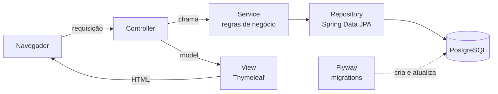
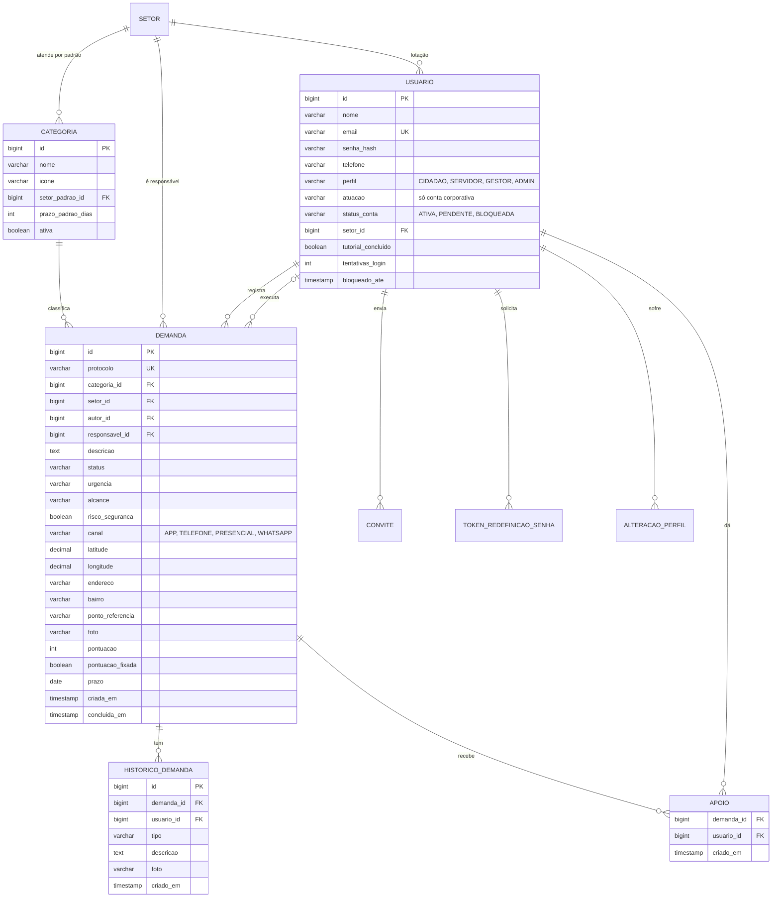
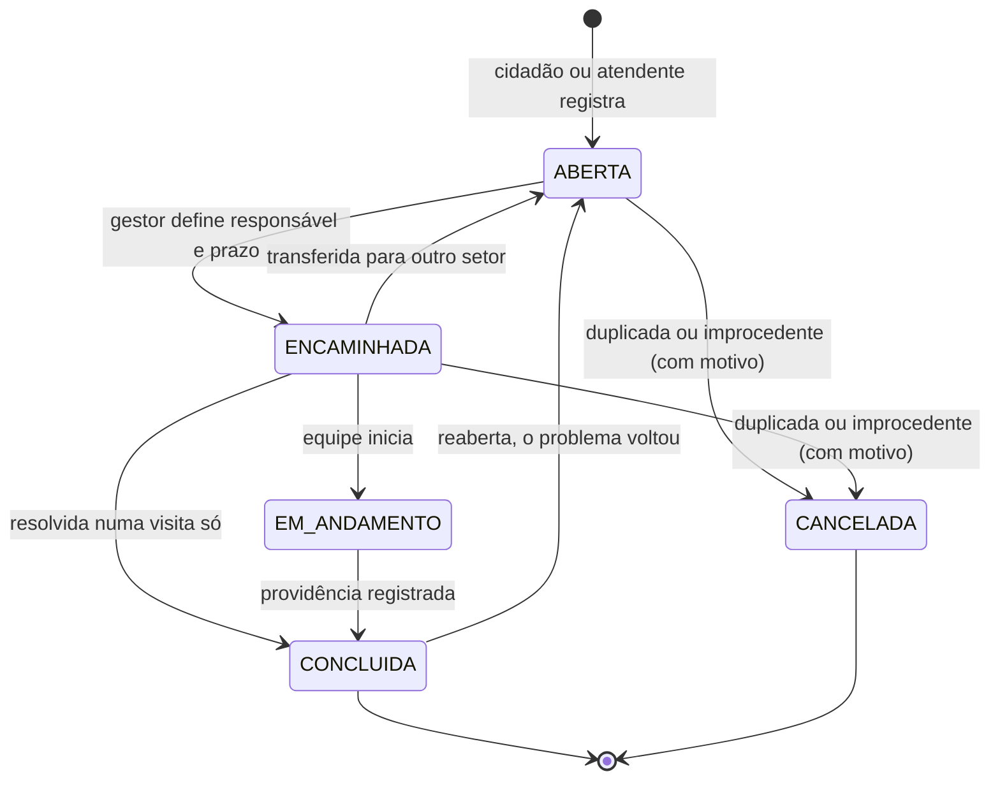

# Plano de Implementação — Denarco

**Desafio:** Como podemos integrar e priorizar as demandas de serviços públicos de Arcoverde para melhorar o atendimento à população?
**Programa:** Desafios PE · Desafios Day · Secretaria de Planejamento e Projetos de Arcoverde
**Formato da solução:** site responsivo em Java (Spring Boot, MVC em camadas) · 4 sprints curtos, entrega na segunda-feira 26/10

---

## 0. Resumo

Um lugar único onde cidadãos e atendentes registram problemas (buraco, poste apagado, lixo, alagamento...) com mapa, foto e protocolo. A Prefeitura encaminha ao setor certo, define responsável e prazo e registra o que foi feito; todos acompanham pelo histórico. A prioridade é calculada por uma fórmula simples e visível, alimentada também pelos apoios da população ("ainda presente"). Painéis e mapa mostram pendências, atrasos e concentrações por bairro.

| Sprint | Tema | Ao final dá para ver... |
|---|---|---|
| 1 | Fundação e acesso | login, cadastro (cidadão e corporativo) e "esqueci minha senha" funcionando no celular |
| 2 | Demandas do cidadão | registrar demanda em até 5 cliques, apoiar demandas, tutorial do cidadão |
| 3 | Atendimento pela Prefeitura | ciclo completo: triagem → responsável e prazo → providência → concluída; convites e promoções. **Já serve para um piloto.** |
| 4 | Painéis, consulta e lançamento | dashboards, mapa territorial, consulta em linguagem simples, tutoriais de todos os perfis, auditoria ISO/IEC 25010 |

### 0.1 Versão para segunda-feira (26/10)

| Sprint | Quando | Checkpoint da equipe |
|---|---|---|
| 1 | sábado 24/10, tarde | rodar o sistema, criar contas, testar login e "esqueci minha senha" |
| 2 | sábado 24/10, noite | registrar demandas pelo celular, apoiar, ver o tutorial do cidadão |
| 3 | domingo 25/10, dia | fazer o ciclo completo com os perfis da Prefeitura |
| 4 | domingo 25/10, noite | painéis, mapa e tutoriais; segunda cedo: ensaio da apresentação |

No fim de cada sprint a equipe roda o sistema e aponta o que não está como esperado; isso é corrigido no início do sprint seguinte.

**Andamento:** Sprint 1 ✅ · Sprint 2 ✅ · Sprint 3 ✅ · Sprint 4 ✅ — MVP concluído com 49 testes automatizados passando.

**Auditoria do Sprint 4 (24/10/2026):**

| Verificação | Resultado |
|---|---|
| Acessibilidade (axe-core, regras WCAG 2.2 A/AA) em 17 telas, modo normal | 0 violações (antes da correção: 4 tipos — contraste de botões, ARIA do tutorial, papel do mapa) |
| Mesma auditoria com alto contraste ligado | 0 violações (antes: 3 tipos — texto sobre amarelo, vermelho sobre preto, link do mapa) |
| Rolagem horizontal no celular (375px) | nenhuma tela |
| Cores dos gráficos (validador de daltonismo e contraste) | azul e laranja aprovados em todos os critérios |
| Permissões por perfil (testes MockMvc) | cidadão, servidor, gestor e admin só entram onde podem |
| HTTPS (perfil `https`) | sobe na porta 8443 com certificado de demonstração |

Ficaram para depois de segunda: teste com leitor de tela real (NVDA/TalkBack), Lighthouse de desempenho, teste de carga e teste SUS com usuários.

**Ajustes para caber no prazo** (o resto do plano continua valendo como meta):
- Sem Docker nesta máquina: em desenvolvimento usamos **H2 em arquivo** (roda sem instalar nada, os dados ficam salvos); o perfil `prod` usa o **PostgreSQL** já instalado. As migrations são escritas em SQL compatível com os dois.
- Sem Mailpit: em desenvolvimento o link de "esqueci minha senha" aparece no console. Com SMTP configurado, vai por e-mail.
- **Convite simplificado:** o gestor ou admin cadastra e-mail + perfil + setor; quando essa pessoa cria a conta corporativa, ela já entra aprovada. Sem link nem e-mail.
- Testes: só os unitários das regras principais (prioridade, status, promoção).
- **Ficam para depois de segunda:** Docker Compose, Testcontainers, CI, bloqueio por tentativas de login, e-mail ao concluir, reabrir demanda, excluir conta, exportação CSV, teste de carga, teste SUS, backup, HTTPS e publicação em servidor.
- **Só se sobrar tempo no Sprint 4:** consulta em linguagem simples (versão por palavras-chave).

---

## 1. O que o desafio pede e onde atendemos

| # | Requisito (fonte) | Sprint |
|---|---|---|
| R01 | Descrição, categoria, localização geográfica, endereço ou ponto de referência (desafio) | 2 |
| R02 | Foto, urgência e alcance do problema, quando pertinente (desafio) | 2 |
| R03 | Identificação própria (protocolo) e histórico de atendimento (desafio) | 2 |
| R04 | Distribuição entre setores, definição de responsáveis e prazos (desafio) | 2 (automática) e 3 |
| R05 | Atualizar a situação e registrar providências (desafio) | 3 |
| R06 | Identificar pendências, atrasos e concentrações territoriais (desafio) | 3 e 4 |
| R07 | Consulta simples, inclusive em linguagem natural, com respostas verificáveis (desafio + caderno) | 4 |
| R08 | Evitar duplicidade de solicitações e perda de histórico (caderno) | 2 |
| R09 | Proteção das informações e permissões de acesso (caderno) | 1 a 3 |
| R10 | Capacitação, suporte e baixo custo de continuidade (caderno) | 2 e 4 |
| R11 | Demonstrações com dados fictícios ou anonimizados (caderno) | 2 |
| R12 | Indicadores com fonte e período; comparação com a condição inicial (caderno) | 4 |
| E01 | Login, cadastro, conta corporativa e "esqueci minha senha" (equipe) | 1 |
| E02 | Cargos mais altos convidam e promovem pessoas (equipe) | 3 |
| E03 | Tutorial guiado por perfil (equipe) | 2 e 4 |
| E04 | Nova demanda em até 5 cliques (equipe) | 2 |
| E05 | Tela inicial no estilo dashboard + apoio "ainda presente" (equipe) | 2 e 4 |
| E06 | Qualidade ISO/IEC 25010 para todos os públicos e dispositivos (equipe) | contínuo, auditoria no 4 |

---

## 2. Arquitetura

### 2.1 Tecnologias

| Parte | Escolha | Por quê |
|---|---|---|
| Linguagem | Java 21 (LTS) | estável e com muito material de estudo |
| Framework | Spring Boot (versão estável do start.spring.io) com Spring Web MVC | MVC pronto, pouca configuração |
| Telas (View) | Thymeleaf + Bootstrap 5 + CSS próprio | HTML gerado no servidor: sem projeto front-end separado, menos código |
| Autenticação | Spring Security (login por formulário + sessão) | já traz CSRF, controle de sessão e proteção de rotas |
| Senhas | `BCryptPasswordEncoder` | ver 2.4 |
| Banco | PostgreSQL (prod) · H2 em arquivo (dev) | gratuito e robusto; H2 roda sem instalar nada |
| Acesso a dados | Spring Data JPA | repositórios sem SQL repetitivo |
| Migrations | Flyway | banco versionado junto com o código |
| E-mail | Spring Mail + Mailpit (em desenvolvimento) | redefinição de senha e avisos |
| Mapa | Leaflet + OpenStreetMap | código aberto, sem custo de licença |
| Gráficos | Chart.js | simples e responsivo |
| Tutorial | Driver.js | destaca o elemento e mostra um balão com progresso, como no colheitadev |
| Testes | JUnit 5, Mockito, Spring Security Test, Testcontainers | |
| Execução | Docker Compose (app + PostgreSQL + Mailpit) | qualquer membro sobe tudo com um comando |

Dependências no start.spring.io (Spring Boot 4.1.2, Java 21): Spring Web, Thymeleaf, Spring Security, Spring Data JPA, PostgreSQL Driver, H2 Database, Flyway Migration, Validation, Java Mail Sender, Spring Boot Actuator, Spring Boot DevTools. Conferir se o `thymeleaf-extras-springsecurity` veio no `pom.xml`; se não, adicionar.

### 2.2 Camadas



Regras que valem para todo o código:

1. **Controller** recebe a requisição, valida o formulário (`@Valid`), chama um service e devolve a view. Não tem regra de negócio e nunca usa repository.
2. **Service** concentra as regras (quem pode o quê, mudanças de status, prioridade) e grava o histórico. Métodos que alteram dados usam `@Transactional`.
3. **Repository** é uma interface do Spring Data JPA. Consultas especiais com `@Query`.
4. **Model** (entidades JPA) nunca é preenchido direto por formulário: usamos classes de formulário (DTOs, pasta `dto/`). Isso impede que alguém envie `perfil=ADMIN` escondido no cadastro.
5. **Migrations** são a única forma de mudar o banco (`spring.jpa.hibernate.ddl-auto=validate`). Migration já aplicada nunca é editada: cria-se uma nova.

### 2.3 Pastas

```
src/main/java/br/com/denarco/
├── config/        SecurityConfig, DadosIniciais (cria o admin na primeira execução)
├── controller/    AuthController, InicioController, DemandaController, GestaoController,
│                  UsuarioController, AdminController, PainelController
│   └── api/       endpoints JSON para mapa, gráficos e aviso de duplicada
├── service/       UsuarioService, SenhaService, ConviteService, DemandaService,
│                  HistoricoService, ApoioService, PrioridadeService, PainelService,
│                  ConsultaService, EmailService, FotoService
├── repository/    uma interface por entidade
├── model/         entidades + enums (Perfil, StatusDemanda, Urgencia, Alcance, Canal...)
├── dto/           formulários e respostas (records)
├── security/      UsuarioDetailsService (carrega o usuário para o Spring Security)
└── exception/     NegocioException + TratadorDeErros (@ControllerAdvice)

src/main/resources/
├── db/migration/  V1__..., V2__... (Flyway)
├── db/demo/       dados fictícios (carregados só no perfil dev)
├── templates/     layout/, auth/, inicio/, demanda/, gestao/, admin/, painel/
├── static/        css/app.css, js/ (nova-demanda, mapa, graficos, tutorial)
└── application.yml
```

### 2.4 Decisões importantes

- **Senhas com BCrypt.** No lugar de uma cifra, usamos o que o Spring já oferece, com a mesma simplicidade: `passwordEncoder.encode(senha)` gera um *hash* de mão única. Uma cifra pode ser revertida com a chave; o hash não. Se o banco vazar, as senhas não vazam. No login, `passwordEncoder.matches(...)` faz a comparação.
- **Sessão em vez de JWT.** Como as telas são geradas no servidor, login por formulário com sessão é o caminho mais simples e já vem com proteção CSRF.
- **Hierarquia de perfis** com `RoleHierarchy` do Spring Security (ADMIN > GESTOR > SERVIDOR > CIDADAO): quem está acima herda as permissões de baixo.
- **"Demanda" no código.** É o termo usado no desafio e inclui o que chamamos de denúncia. Na tela, o botão pode se chamar "Relatar problema".
- **Sem Lombok.** Getters e setters gerados pela IDE: o código fica explícito para quem está aprendendo.
- **Dados de demonstração em Java** (`config/DadosDemo`, só no perfil `dev`), porque as senhas precisam passar pelo BCrypt.
- **Configuração por variáveis de ambiente** (`DB_URL`, `DB_USER`, `DB_PASSWORD`, `MAIL_HOST`, `ADMIN_EMAIL`, `ADMIN_SENHA`). Nenhuma senha no código.

### 2.5 Padrão de comentários

Javadoc curto no topo de cada classe dizendo **qual é o papel dela**. Dentro dos métodos, comentário só quando explica **por quê** (regra de negócio, decisão que não é óbvia). Getters, setters e código autoexplicativo não levam comentário.

```java
/**
 * Calcula a prioridade de uma demanda (0 a 100).
 * A fórmula aparece na tela da demanda em "Por que esta prioridade?",
 * para que qualquer servidor consiga conferir o resultado.
 */
@Service
public class PrioridadeService {

    // Apoios valem no máximo 20 pontos: uma demanda muito apoiada
    // não pode passar na frente de um problema com risco à segurança.
    private static final int MAXIMO_PONTOS_APOIO = 20;

    // ...
}
```

---

## 3. Perfis e acesso

| Perfil | Quem é | O que faz |
|---|---|---|
| CIDADAO | morador, associação | registra demandas, acompanha as suas, apoia as de outras pessoas |
| SERVIDOR | atendimento e triagem, equipes de campo | vê as demandas do seu setor, registra demandas recebidas por telefone ou presencialmente, atualiza status, registra providências |
| GESTOR | gestor de secretaria, planejamento e controle | tudo do servidor + encaminha entre setores, define responsável e prazo, ajusta prioridade com justificativa, painel do setor, convida e aprova servidores |
| ADMIN | Secretaria de Planejamento (responsável pelo sistema) | tudo + setores, categorias, todos os usuários, painel geral |

Gestor ou admin sem setor definido enxerga todos os setores (caso de planejamento e controle).

**Convidar e promover.** Só é possível convidar ou promover alguém para um perfil **abaixo** do seu (o ADMIN também pode nomear outro ADMIN). Ninguém altera o próprio perfil nem o de alguém do mesmo nível ou acima. O GESTOR só mexe em pessoas do próprio setor. Toda mudança fica registrada: quem fez, quando, de qual perfil para qual.

**Conta corporativa.** Na tela de login há "Criar conta corporativa". Além de nome, e-mail, senha e telefone, a pessoa escolhe:

- **Área de atuação** (público-alvo do desafio): Atendimento e triagem · Equipe de campo · Gestão de secretaria · Planejamento e controle.
- **Setor** (lista inicial do caderno, editável pelo admin): Pavimentação · Iluminação pública · Limpeza urbana · Drenagem · Conservação de espaços públicos.

Sem convite, a conta nasce **PENDENTE**: a pessoa entra como cidadão, vê o aviso "aguardando aprovação" e espera um gestor do setor ou um admin aprovar e confirmar o perfil. Com um link de convite, a conta já nasce aprovada com o perfil e o setor do convite. Sem essa etapa, qualquer pessoa poderia se cadastrar como servidor e ver dados de cidadãos.

---

## 4. Dados e regras

### 4.1 Modelo de dados



- `APOIO` tem chave única (`demanda_id`, `usuario_id`): um apoio por pessoa.
- `HISTORICO_DEMANDA` só recebe inserções, nunca é alterado ou apagado. É a trilha de auditoria da demanda.
- Protocolo: `ARC-{ano}-{id com 6 dígitos}`, por exemplo `ARC-2026-000123`.

### 4.2 Status da demanda



As transições permitidas ficam num método do enum (`StatusDemanda.podeMudarPara`) e têm teste. A categoria já define o setor quando a demanda é criada; a categoria "Outros" vai para a triagem geral.

### 4.3 Prioridade (simples e conferível)

| Fator | Pontos |
|---|---|
| Urgência | Baixa 10 · Média 20 · Alta 35 · Risco à segurança 50 |
| Alcance | Um ponto ou imóvel 5 · Uma rua 10 · Bairro ou mais 20 |
| Apoios | 2 por apoio, no máximo 20 |
| Tempo em aberto | 1 por dia, no máximo 10 |

Faixas: **Alta** ≥ 60 · **Média** 35 a 59 · **Baixa** < 35. Os pesos são um ponto de partida e devem ser validados com a Prefeitura.

- A pontuação é recalculada a cada mudança e toda madrugada por uma tarefa agendada (`@Scheduled`).
- A tela da demanda mostra a conta: "72 = urgência alta (35) + bairro (20) + 6 apoios (12) + 5 dias (5)".
- O gestor pode fixar outra prioridade, com justificativa obrigatória que vai para o histórico. A fórmula sugere; quem decide é o servidor público.
- **Atrasada** = prazo vencido e status diferente de CONCLUIDA ou CANCELADA.

### 4.4 Evitar duplicadas

Quando o cidadão escolhe categoria e local, o sistema procura demandas abertas da mesma categoria num raio de cerca de 100 m (comparando faixas de latitude e longitude, sem extensão geográfica no banco). Se encontrar, mostra "Já existe uma igual a 80 m" com o botão **Apoiar esta**, em vez de criar outra.

---

## 5. Telas

### 5.1 Regras visuais

- Uma ação principal por tela, em destaque. O resto fica em segundo plano.
- Letra grande só onde importa: números dos cards ~40px, títulos 24–28px, texto 16–18px, nada abaixo de 14px.
- No topo do painel, no máximo 4 cards de números; abaixo, 1 ou 2 gráficos e uma lista curta. Detalhes ficam atrás de "Ver mais".
- Ícone sempre acompanhado de texto. Status com cor **e** texto, sem depender só da cor.
- Pensado primeiro para celular: funciona a partir de 360px de largura, áreas de toque com pelo menos 44×44px, botão "Nova demanda" fixo no rodapé (celular) ou no topo (computador).
- Barra de acessibilidade em todas as páginas: A+ / A−, alto contraste e VLibras (widget gratuito do governo federal que traduz para Libras).
- Frases curtas e sem jargão: "Encaminhada para Iluminação pública" em vez de "Status: ENCAMINHADA".

### 5.2 Telas por perfil

| Quem | Telas |
|---|---|
| Todos (sem login) | Entrar · Criar conta · Criar conta corporativa · Esqueci minha senha · Redefinir senha · Aceitar convite |
| Cidadão | Início · Nova demanda · Detalhe da demanda · Minhas demandas · Minha conta |
| Servidor | Início (minhas tarefas) · Fila do setor · Detalhe com ações · Registrar demanda em nome do cidadão |
| Gestor | Início (painel do setor) · Triagem · Equipe (convites e aprovações) · Mapa · Consulta |
| Admin | Painel geral · Mapa · Consulta · Usuários · Setores · Categorias |

### 5.3 Início do cidadão (celular)

```
┌─────────────────────────────────────┐
│ Denarco        [A+] [A-] [Contraste]│
├─────────────────────────────────────┤
│ Olá, Maria                          │
│ ┌─────────┐ ┌─────────┐ ┌─────────┐ │
│ │    3    │ │    1    │ │   12    │ │
│ │ abertas │ │concluída│ │ apoios  │ │
│ └─────────┘ └─────────┘ └─────────┘ │
│                                     │
│ Minhas demandas em aberto           │
│ • Poste apagado · Centro            │
│   Em andamento · prazo 30/10        │
│ • Buraco na via · Bairro X          │
│   Encaminhada · 8 apoios            │
│                                     │
│ Perto de você                       │
│ • Lixo acumulado · Bairro Y         │
│   15 apoios    [Ainda presente]     │
│                                     │
│  [         + Nova demanda        ]  │
├─────────────────────────────────────┤
│  Início    Mapa    Minhas    Menu   │
└─────────────────────────────────────┘
```

"Perto de você" usa a localização do celular; se a pessoa não permitir, mostra as demandas mais apoiadas.

### 5.4 Nova demanda em até 5 cliques

| Clique | Ação | Detalhe |
|---|---|---|
| 1 | **Nova demanda** | botão fixo, visível em todas as telas |
| 2 | **Categoria** | cards grandes com ícone (Buraco, Poste apagado, Lixo...) |
| 3 | **Usar minha localização** | ou tocar no mapa; endereço e bairro são preenchidos e podem ser corrigidos. Se já existir uma igual por perto: **Apoiar esta** e pronto |
| — | Descrição | o campo já recebe o foco: é só digitar |
| 4 | Foto *(opcional)* | abre a câmera no celular |
| 5 | **Enviar** | mostra o protocolo (`ARC-2026-000123`) e o link para acompanhar |

Urgência, alcance e ponto de referência são opcionais e têm valor padrão, então não entram na conta. É um formulário só, que vai se revelando por partes (sem várias páginas).

### 5.5 Tutorial por perfil

No estilo do colheitadev: card com título, uma ou duas linhas de texto, bolinhas de progresso, botões "Pular tutorial", "Voltar" e "Próximo", destacando o elemento da tela que está sendo explicado. Aparece no primeiro acesso (campo `tutorial_concluido`), pode ser revisto pelo menu e funciona pelo teclado (setas e Esc).

| Perfil | Passos |
|---|---|
| Cidadão | boas-vindas → botão Nova demanda → minhas demandas → perto de você e "Ainda presente" → protocolo e linha do tempo → acessibilidade → onde rever o tutorial |
| Servidor | boas-vindas → fila do setor → prioridade e atrasadas → abrir uma demanda → registrar providência → concluir → registrar demanda recebida por telefone |
| Gestor | boas-vindas → triagem → responsável e prazo → "Por que esta prioridade?" → painel do setor → equipe (convites e aprovações) |
| Admin | passos do gestor + setores e categorias → usuários e promoções → mapa geral |

---

## 6. Sprints

### Sprint 1 — Fundação e acesso

**Objetivo:** o projeto roda em qualquer máquina com um comando, e o acesso completo (entrar, criar conta, recuperar senha) funciona no celular.

**Entregas**
- Projeto gerado no start.spring.io com as pastas da seção 2.3, `docker-compose.yml` (PostgreSQL + Mailpit), perfis `dev` e `prod` no `application.yml`, README com "como rodar".
- Layout base em Thymeleaf (cabeçalho, menu, rodapé, barra de acessibilidade), `app.css` com cores e tamanhos de letra em variáveis CSS, página de erro amigável.
- `SecurityConfig`: login por e-mail e senha, `BCryptPasswordEncoder`, sessão de 30 min, logout, CSRF, rotas protegidas por perfil com `RoleHierarchy`.
- Cadastro de cidadão: nome, e-mail, senha (mínimo 8 caracteres, botão mostrar/ocultar), telefone e aceite do aviso de privacidade.
- Cadastro corporativo com área de atuação e setor, criando a conta como PENDENTE (seção 3).
- Esqueci minha senha: token aleatório (UUID), válido por 30 min e de uso único, enviado por e-mail. A resposta é sempre "se o e-mail estiver cadastrado, enviaremos um link", para não revelar quem tem conta.
- Bloqueio de 15 min após 5 senhas erradas seguidas.
- Admin inicial criado na primeira execução a partir de `ADMIN_EMAIL` e `ADMIN_SENHA`.
- Tela inicial provisória por perfil ("Olá, Maria — perfil Cidadão").
- Em paralelo, fora do código: levantamento com a Prefeitura (seção 11).

**Banco:** `V1__criar_setor.sql` · `V2__criar_usuario.sql` · `V3__criar_token_redefinicao_senha.sql` · `V4__inserir_setores_iniciais.sql`

**Rotas:** `/login` · `/cadastro` · `/cadastro/corporativo` · `/senha/esqueci` · `/senha/redefinir?token=` · `/`

**Demo:** no celular, criar conta → sair → "esqueci minha senha" → abrir o link no Mailpit → trocar a senha → entrar. Criar uma conta corporativa e ver "aguardando aprovação".

**Pronto quando:** a coluna de senha no banco só tem hashes BCrypt (começam com `$2a$`); todas as telas funcionam a 360px e só com teclado; testes de `UsuarioService` e `SenhaService` passando.

### Sprint 2 — Demandas do cidadão

**Objetivo:** o cidadão registra uma demanda em até 5 cliques, acompanha pelo protocolo e apoia demandas de outras pessoas.

**Entregas**
- Formulário de nova demanda (seção 5.4): categorias em cards, mapa Leaflet com "usar minha localização" e pino arrastável, endereço e bairro preenchidos a partir do ponto (editáveis), ponto de referência (essencial na zona rural), descrição, foto, urgência e alcance opcionais e a pergunta "há risco à segurança?", que mostra o aviso "Em perigo imediato, ligue 193 (Bombeiros) ou 199 (Defesa Civil)".
- `FotoService`: aceita JPG ou PNG até 10 MB, redimensiona para no máximo 1600px e regrava a imagem, o que remove os metadados (GPS e modelo do celular). As fotos ficam fora da pasta pública e são servidas por um controller que confere a permissão.
- Protocolo `ARC-2026-000123` e encaminhamento automático ao setor padrão da categoria.
- Aviso de possível duplicada com o botão "Apoiar esta" (seção 4.4).
- Página da demanda: dados, foto, linha do tempo (histórico) e botão "Ainda presente".
- Apoio: um por pessoa, clicar de novo desfaz. Mostra o total e a data do último apoio ("último apoio há 2 dias" mostra que o problema continua).
- Início do cidadão (seção 5.3).
- Tutorial: Driver.js, tour do cidadão, campo `tutorial_concluido`, "Rever tutorial" no menu.
- Dados fictícios para demonstração, carregados só no perfil `dev`.

**Banco:** `V5__criar_categoria.sql` (com as categorias iniciais) · `V6__criar_demanda.sql` · `V7__criar_historico_demanda.sql` · `V8__criar_apoio.sql` · dados fictícios em `config/DadosDemo`

**Rotas:** `/demandas/nova` · `POST /demandas` · `/demandas/{protocolo}` · `POST /demandas/{id}/apoio` · `/demandas/{id}/foto` · `/api/demandas/proximas` · `POST /tutorial/concluido`

**Demo:** duas pessoas com dois celulares. A primeira registra uma demanda contando os cliques em voz alta; a segunda tenta registrar o mesmo problema, recebe o aviso de duplicada e apoia.

**Pronto quando:** caminho mínimo de até 5 cliques medido no celular; foto salva sem metadados; nome do autor e foto nunca aparecem para outros cidadãos; testes da busca de duplicadas e do apoio passando.

### Sprint 3 — Atendimento pela Prefeitura

**Objetivo:** o ciclo completo funciona (registro → triagem → execução → conclusão) e cada perfil só faz o que pode. Ao final deste sprint o sistema já serve para um piloto.

**Entregas**
- Fila do setor ordenada por prioridade, com filtros (status, categoria, bairro, atrasadas) e paginação. Vira a tela inicial do servidor e do gestor.
- Triagem (gestor): trocar o setor, definir responsável e prazo (sugerido pelo prazo padrão da categoria), corrigir urgência e alcance, cancelar com motivo. Se for duplicada, liga à demanda original.
- Execução (servidor): iniciar atendimento, registrar providência (texto + foto opcional), concluir.
- Registro em nome do cidadão: o atendente registra demandas recebidas por telefone, presencialmente ou por WhatsApp, marcando o canal de origem. É isso que **integra** os canais numa base só.
- `PrioridadeService` (seção 4.3) com "Por que esta prioridade?", ajuste manual com justificativa e a tarefa noturna que recalcula prioridades e atrasos.
- Transições de status validadas (seção 4.2); cada ação vira um item do histórico com quem fez e quando.
- Usuários: link de convite (perfil + setor, válido por 7 dias), aprovação de contas corporativas pendentes, promoção e rebaixamento seguindo a regra da seção 3.
- Admin: cadastro de setores e categorias. Desativar em vez de apagar, para não quebrar o histórico.
- Exportar a lista filtrada em CSV.
- *(extra)* E-mail ao autor quando a demanda for concluída; o autor pode reabrir em até 7 dias se o problema voltar.

**Banco:** `V9__criar_convite.sql` · `V10__criar_alteracao_perfil.sql`

**Rotas:** `/gestao/fila` · `POST /gestao/demandas/{id}/encaminhar` · `.../status` · `.../providencias` · `.../prioridade` · `/gestao/equipe` · `POST /convites` · `/convite/{token}` · `POST /usuarios/{id}/perfil` · `/admin/setores` · `/admin/categorias` · `/gestao/exportar.csv`

**Demo:** cidadão registra → gestor encaminha com prazo → servidor conclui com foto → cidadão vê a linha do tempo completa. Depois, um gestor tenta promover alguém a ADMIN e é impedido; um servidor de Iluminação tenta abrir pela URL uma demanda de Drenagem e recebe "acesso negado".

**Pronto quando:** testes de permissão (Spring Security Test) para cada rota de gestão e de admin; testes de `StatusDemanda.podeMudarPara` e de `UsuarioService.promover` passando.

### Sprint 4 — Painéis, consulta e lançamento

**Objetivo:** gestores enxergam pendências, atrasos e concentrações no território; o sistema passa pela auditoria de qualidade e vai para o piloto.

**Entregas**
- Painel por perfil: até 4 cards (abertas, atrasadas, concluídas no período, tempo médio de atendimento), gráficos Chart.js (por categoria, por status, evolução semanal) e ranking de bairros. Todo número mostra fonte e período ("Fonte: Denarco · 01/10 a 24/10"). As contas são feitas no banco (`COUNT ... GROUP BY`), não em laços no Java.
- Mapa territorial: marcadores agrupados (Leaflet.markercluster), cor por prioridade e filtros de categoria, status e período.
- Consulta em linguagem simples: caixa "Pergunte", por exemplo "iluminação atrasada no Centro". O `ConsultaService` transforma a frase em filtros usando um dicionário de palavras (buraco → Pavimentação; poste, lâmpada → Iluminação; lixo, entulho → Limpeza; bueiro, alagamento → Drenagem; praça, mato → Conservação), os bairros já registrados e expressões de tempo ("este mês", "esta semana"). A tela mostra os filtros entendidos como etiquetas editáveis, junto com o resultado: a resposta é sempre conferível.
- Tours do servidor, do gestor e do admin (feitos agora porque as telas deles já estão estáveis).
- Auditoria ISO/IEC 25010 (seção 7).
- `V11__criar_indices.sql`: índices para status, setor, categoria, bairro e data de criação.
- LGPD: aviso de privacidade e "Minha conta" (ver, editar e excluir a conta).
- Lançamento: Docker Compose de produção, HTTPS, backup diário (`pg_dump`) com um teste de restauração, `/actuator/health`, página de Ajuda e guia de 1 página por perfil.
- Avaliação do piloto: teste com 5 pessoas (cidadãos e servidores) e questionário SUS; comparar os indicadores com a situação inicial levantada no Sprint 1.

**Banco:** `V11__criar_indices.sql`

**Rotas:** `/painel` · `/mapa` · `/consulta?q=` · `/minha-conta` · `/api/painel/*` · `/api/mapa`

**Demo final:** a história completa, do cidadão ao painel do gestor, com dados fictícios.

**Pronto quando:** todos os critérios da seção 7 atendidos, ou com a pendência registrada e justificada.

---

## 7. Qualidade — ISO/IEC 25010

A ISO/IEC 25010 (versão 2023) é um modelo de qualidade com 9 características, não uma lista de regras prontas. Por isso cada característica abaixo virou ações concretas e uma forma de verificar.

| Característica | O que fazemos | Como verificamos |
|---|---|---|
| **Adequação funcional** (completude, correção, adequação) | tabela de requisitos da seção 1; critério "pronto quando" em cada sprint | checklist R01–E06 na demo final; testes dos services |
| **Eficiência de desempenho** (tempo, uso de recursos, capacidade) | paginação de 20 itens, índices nas colunas filtradas, contas feitas no banco, fotos redimensionadas, páginas sem framework pesado | Lighthouse (celular) ≥ 80 em desempenho; listas e painel abrindo em menos de 2 s com 10 mil demandas fictícias |
| **Compatibilidade** (coexistência, interoperabilidade) | HTML padrão; exportação CSV (abre em planilha); endpoints JSON reaproveitáveis em integrações futuras | testes em Chrome, Firefox, Edge, Safari (iPhone) e Chrome (Android) |
| **Capacidade de interação** (antiga usabilidade: reconhecimento, aprendizado, operação, proteção contra erros, engajamento, inclusão, assistência, autodescrição) | até 5 cliques, tutorial por perfil, textos curtos, mensagens de erro que dizem como corrigir, confirmação antes de ações irreversíveis, WCAG 2.2 AA e eMAG, A+/A−, alto contraste, VLibras, navegação por teclado, rótulos para leitor de tela, celular primeiro | axe e Lighthouse ≥ 95 em acessibilidade em todas as telas; teste com teclado e leitor de tela (NVDA e TalkBack); teste com 5 usuários reais + questionário SUS |
| **Confiabilidade** (ausência de falhas, disponibilidade, tolerância a falhas, recuperação) | `@Transactional` nos services, tratamento global de erros (página amigável, sem stack trace), endereço digitado se o GPS ou o mapa falharem, backup diário, health check | testes de integração; restaurar um backup de verdade antes do lançamento |
| **Segurança** (confidencialidade, integridade, não repúdio, responsabilização, autenticidade, resistência) | BCrypt, Spring Security, perfis + restrição por setor, CSRF, sessão de 30 min, bloqueio após 5 tentativas, token de senha de uso único, upload só de imagem, fotos com checagem de permissão, histórico imutável, HTTPS em produção | testes de permissão por perfil (inclusive tentando URLs diretas); conferir que não há senha em texto no banco; checklist básico do OWASP Top 10 |
| **Manutenibilidade** (modularidade, reuso, análise, modificação, testabilidade) | camadas da seção 2, nomes claros em português, comentários de "por quê", migrations versionadas, PR revisado, integração contínua rodando `mvn verify` | build verde em todo PR; todo service com regra de negócio tem teste |
| **Flexibilidade** (antiga portabilidade: adaptabilidade, escalabilidade, instalação, substituição) | Docker Compose, configuração por variáveis de ambiente, setores, categorias e prazos editáveis pela tela, só software livre (sem fornecedor obrigatório), mapa e e-mail trocáveis por configuração | subir o sistema do zero numa máquina limpa seguindo só o README |
| **Segurança operacional** (nova em 2023: restrição operacional, identificação de risco, falha segura, alerta de perigo) | "há risco à segurança?" leva a prioridade ao máximo e mostra o aviso com 193 e 199; a fórmula só sugere, a decisão é sempre de um servidor | registrar uma demanda com risco e conferir que ela vai para o topo da fila e mostra o aviso |

---

## 8. Proteção de dados (LGPD)

- Coletamos só o necessário: nome, e-mail e telefone.
- Outros cidadãos nunca veem o autor nem a foto de uma demanda; veem categoria, descrição, bairro, status e apoios.
- Telefone e e-mail do autor só aparecem para a equipe responsável pela demanda, para contato.
- Demonstrações só com dados fictícios. Dados reais apenas com autorização da Prefeitura, como pede o caderno.
- Excluir a conta anonimiza os dados pessoais; a demanda e o histórico continuam, porque são registros do atendimento.
- Logs nunca guardam senha, token ou foto.

---

## 9. Como a equipe trabalha

- **Quadro** (GitHub Projects ou Trello): Backlog → Sprint → Fazendo → Revisão → Pronto.
- **Git:** `main` sempre funcionando; uma branch por tarefa (`feat/nova-demanda`); Pull Request revisado por outra pessoa; GitHub Actions roda `mvn verify` em cada PR.
- **Ritmo:** planejamento no primeiro dia do sprint; conversa rápida 2 a 3 vezes por semana; no último dia, demo e retrospectiva. O que ficou diferente do esperado vira item no backlog do próximo sprint, sem mudar o sprint em andamento.

**Definição de pronto** (vale para toda tarefa):
- [ ] Funciona no celular (360px), no tablet e no computador
- [ ] Dá para usar só com o teclado, com contraste adequado
- [ ] Regra de negócio está no service e tem teste
- [ ] Mudança no banco foi feita com uma nova migration
- [ ] Nenhuma senha ou segredo no código
- [ ] Comentários só onde explicam o "por quê"
- [ ] Revisado por outra pessoa da equipe

---

## 10. Fora do escopo e riscos

**Fora do escopo desta versão:** aplicativo nativo (o site é responsivo e pode virar PWA depois), integração com sistemas que a Prefeitura já usa (depende do levantamento), IA generativa (a consulta por regras já atende e não tem custo; um modelo de linguagem poderia ser plugado depois gerando os mesmos filtros, nunca SQL), notificações por WhatsApp ou SMS, uso por vários municípios.

| Risco | O que fazemos |
|---|---|
| GPS impreciso ou zona rural sem nome de rua | pino arrastável no mapa + ponto de referência |
| Internet fraca | páginas leves, fotos redimensionadas, sem SPA pesada |
| Setores e categorias reais diferentes dos iniciais | tudo editável pelo admin; os dados iniciais são só ponto de partida |
| Limite de uso dos servidores públicos de mapa do OpenStreetMap | suficiente para o piloto; em produção, trocar a URL por um provedor de mapas ou servidor próprio |
| Escopo crescer no meio do caminho | lista de fora do escopo; novidades vão para o backlog, não para o sprint atual |
| Contas corporativas falsas | aprovação por gestor ou convite (seção 3) |

---

## 11. Perguntas para o levantamento com a Prefeitura

Fazer durante o Sprint 1, como pede o caderno de contexto.

1. Por quais canais as demandas chegam hoje (telefone, WhatsApp, presencial, ouvidoria) e quem registra?
2. Quais secretarias e setores atendem cada tipo de problema? Existe uma lista oficial?
3. Há algum sistema ou planilha em uso? Será preciso importar dados?
4. Qual o prazo esperado para cada tipo de serviço?
5. Quem pode aprovar contas de servidores? Existe e-mail institucional?
6. Onde o sistema será hospedado: servidor da Prefeitura ou nuvem?
7. Quais indicadores a gestão já acompanha, para comparar o antes e o depois? Com qual fonte e período?
8. Há autorização para usar dados reais no piloto?
